# Handwriting Font & Natural PDF Generator (`handwriting-font-pdf`)

[](#installation)
[](#installation)
[](#python-setup)
[](#key-features)
[](./LICENSE)

Turn phone photos of handwritten character sheets and notebook pages into **smooth, slim-stroke `.ttf` & `.otf` fonts** and **authentic multi-page handwritten PDFs** with formulas, matrices, boxed tables, block diagrams, and natural page physics — powered directly by **Claude Code** or **Google Antigravity**.

---

## Visual Showcase (Real Examples & Outputs)

### 1. Input Samples → Generated Fonts (`.ttf` & `.otf`)

| Input: Handwritten Characters (`0–9, A–Z, a–z`) | Input: Greek & Math Symbols | Output: Smooth Vector Glyph Sheet (`148+` glyphs) |
| :---: | :---: | :---: |
| 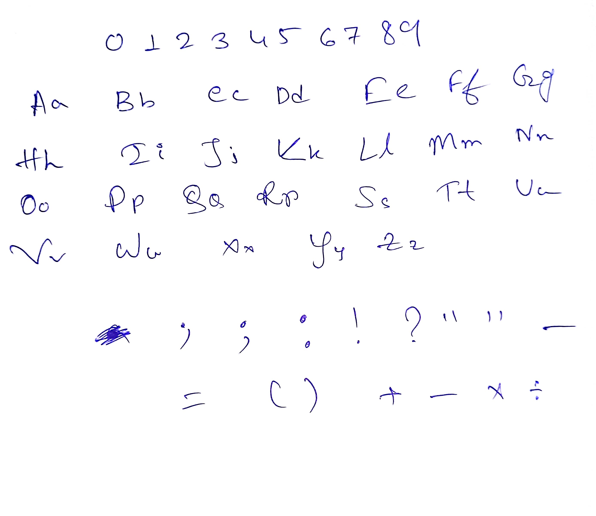 | 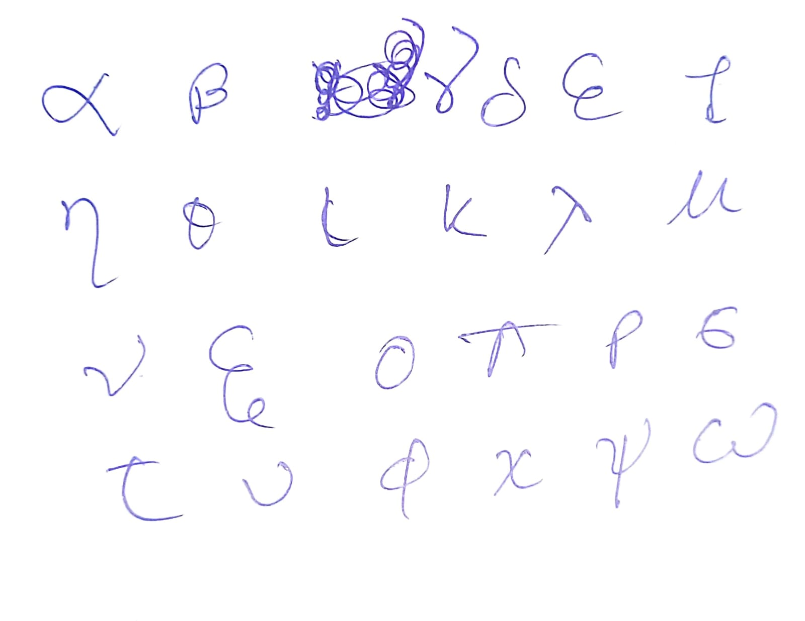 | 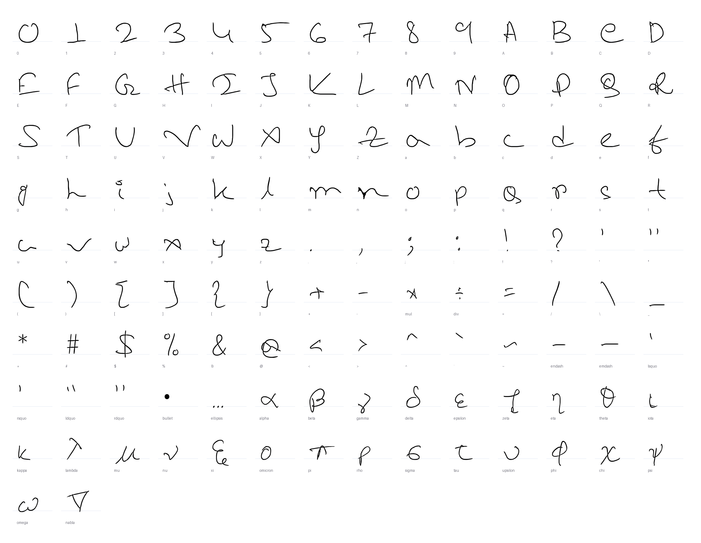 |

**Rendered Specimen (`TTF` & `OTF` mixed text & equations):**

<p align="center">
  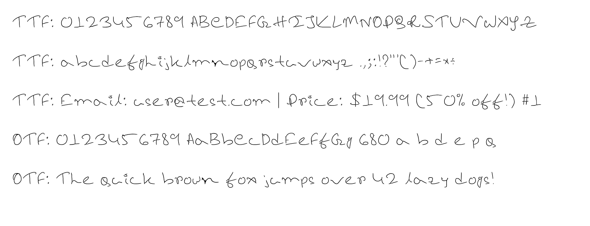
</p>

### 2. Writing Flow Reference → Handwritten Assignment PDF (`< 10 MB`)

| Input: Writing Flow & Angle Reference | Output: Cover Page | Output: Math + Boxed Table | Output: Diagrams + Equations |
| :---: | :---: | :---: | :---: |
| 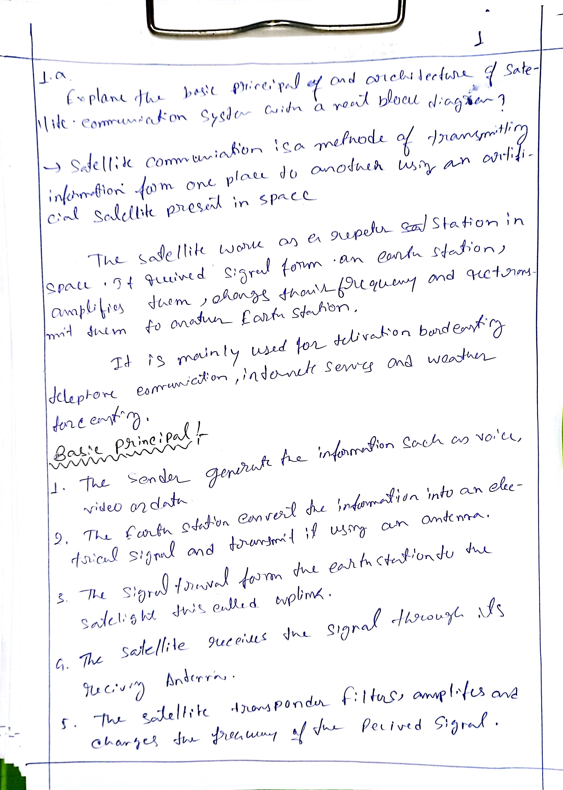 | 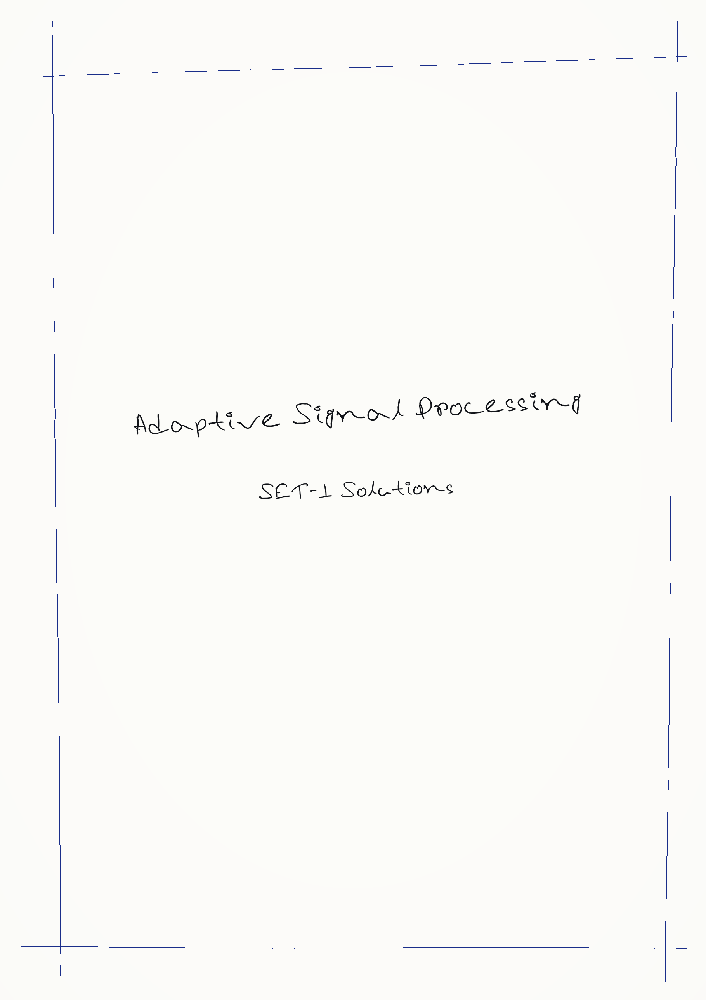 | 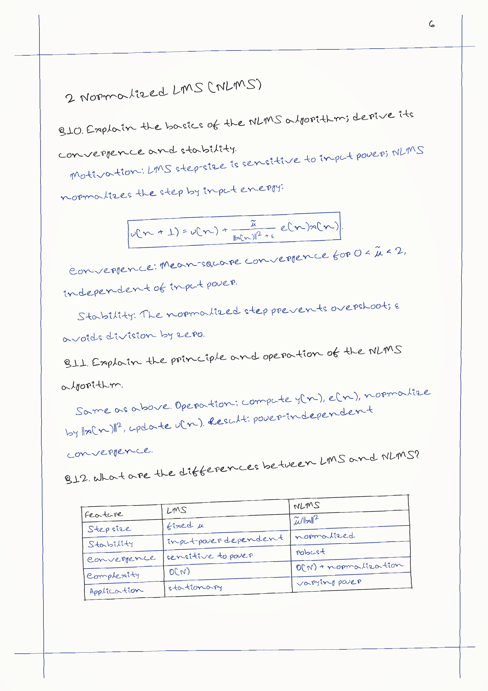 | 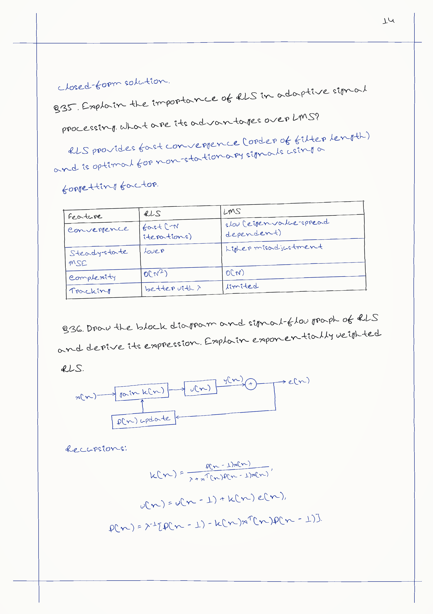 |

### 3. Supports Multiple Independent Handwriting Profiles

| Profile 2 Input Sheet | Profile 2 Flow Sample | Profile 2 Rendered Output |
| :---: | :---: | :---: |
| 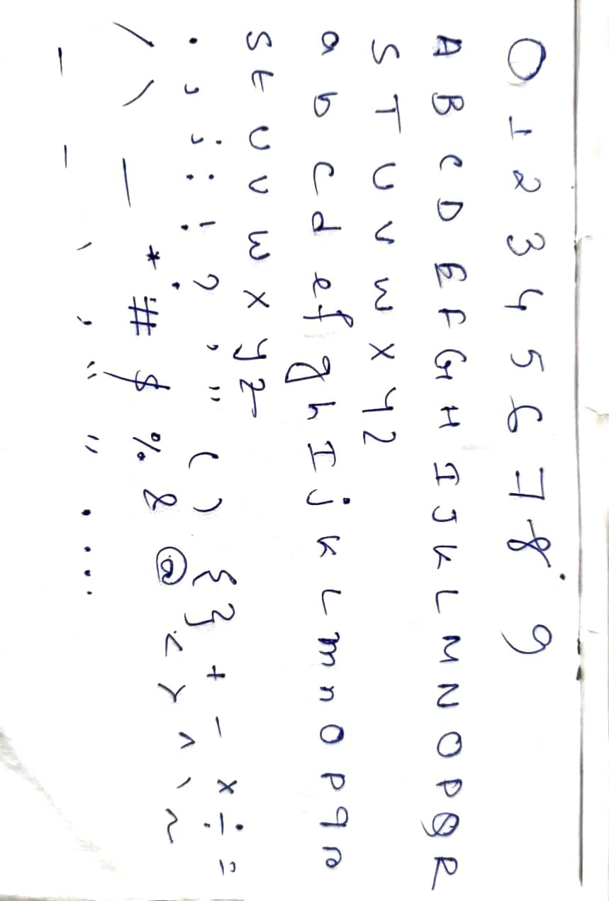 | 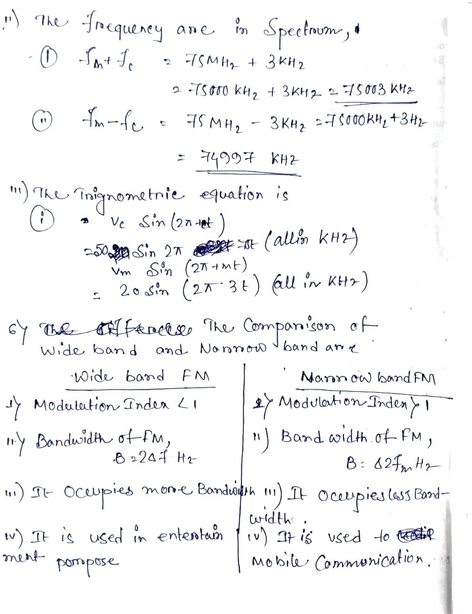 | 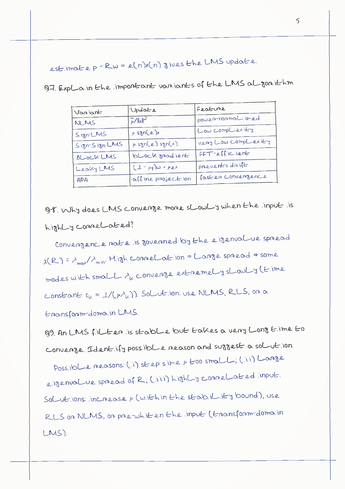 |

---

## Key Features

- **Uniform Slim Strokes & Preserved Loops:** Euclidean distance-transform + Gaussian SDF stroke normalization eliminates blocky fattening while keeping closed holes crisp (`a, b, d, e, g, o, p, q, 0, 4, 6, 8, 9, α, δ, θ, φ, ∇`).
- **Dual `.ttf` + `.otf` Export:** Compiles smooth TrueType quadratic B-splines (`TTGlyphPen`) alongside lossless `Qu2CuPen` OpenType CFF outlines (`T2CharStringPen`), paired with a hollow `.notdef` fallback (zero solid black boxes).
- **Bleed-Through & Stain Resilient:** Separates dark/blue ink from warm paper shadows and two-sided bleed-through specks.
- **Natural Handwriting Physics:**
  - Measures exact baseline angle & ink tone from your reference notebook photo (`analyze_sheet.py --flow`).
  - Dual ink pairing: crisp **black `.otf`** for cover titles, section headings, and questions; **pen blue `.ttf`** for answers, equations, matrices, and diagrams.
  - Per-page base angle + per-line angle jitter + horizontal random-walk line starts + gentle baseline wave.
  - Hand-drawn **4-side randomized margins** (top, bottom, left, right) and **organic boxed grid tables**.
- **Print-Sharp & Lightweight:** Renders at `220 DPI` A4 and auto-tunes JPEG compression to stay **under `10 MB`**.

---

## Installation

### Python Setup
Requires **Python 3.10+**. Install dependencies:

```bash
pip install -r requirements.txt
```

<details>
<summary>Dependencies included in <code>requirements.txt</code></summary>

- `opencv-python>=4.8.0` — ink isolation, connected components, contour extraction
- `numpy>=1.24.0` — paper vignette & vectorized SDF math
- `Pillow>=10.0.0` — subpixel text strips, rotated pasting, JPEG compression
- `scipy>=1.10.0` — image/signal utilities
- `fonttools>=4.43.0` — TrueType (`TTF`) & CFF OpenType (`OTF`) compilation
- `pymupdf>=1.23.0` — source PDF extraction & compressed multi-page PDF export

</details>

### Option A — Install in **Claude Code**

**Project-scoped (for the current repo):**
```bash
mkdir -p .claude/skills
cp -r skills/handwriting-font-pdf .claude/skills/handwriting-font-pdf
```

**Global (available in every Claude Code project):**
```bash
mkdir -p ~/.claude/skills
cp -r skills/handwriting-font-pdf ~/.claude/skills/handwriting-font-pdf
```

*(Windows PowerShell global install)*:
```powershell
New-Item -ItemType Directory -Force "$HOME\.claude\skills" | Out-Null
Copy-Item -Recurse -Force ".\skills\handwriting-font-pdf" "$HOME\.claude\skills\handwriting-font-pdf"
```

### Option B — Install in **Google Antigravity**

**Workspace-scoped:**
```powershell
New-Item -ItemType Directory -Force ".agents\skills" | Out-Null
Copy-Item -Recurse -Force ".\skills\handwriting-font-pdf" ".agents\skills\handwriting-font-pdf"
```

**Global Skill (`~/.gemini/config/skills/`):**
```powershell
New-Item -ItemType Directory -Force "$HOME\.gemini\config\skills" | Out-Null
Copy-Item -Recurse -Force ".\skills\handwriting-font-pdf" "$HOME\.gemini\config\skills\handwriting-font-pdf"
```

**Or install the full repo as an Antigravity Plugin** (uses [`plugin.json`](./plugin.json)):
```powershell
Copy-Item -Recurse -Force "." "$HOME\.gemini\config\plugins\handwriting-font-pdf"
```

### Option C — Universal CLI Installer (`skills` CLI)
```bash
npx skills add riCk97306/handwriting-font-pdf
```

---

## Prompt Playbook (What Prompts Users Should Type)

Once installed, place your photos and target PDF in your workspace folder and prompt **Claude** or **Antigravity**:

### 1. Build `.ttf` & `.otf` Fonts from Photos
```text
Use the handwriting-font-pdf skill to build "MyHandwriting font.ttf" and "MyHandwriting font.otf"
from "letters.jpg" and "symbols.jpg". Keep strokes slim and uniform, preserve inner loops,
avoid any missing-glyph black boxes, and generate glyph verification preview images.
```

### 2. Patch Specific Letters or Add Greek / Math Symbols
```text
Add Greek letters (α–ω) and ∇ from "greek_sheet.jpg" into my existing TTF and OTF fonts,
replace lowercase "w" using "new_w.jpg", and verify "μ" works properly without affecting
any previously working letters.
```

### 3. Convert a PDF into a Handwritten Assignment
```text
Convert "Assignment.pdf" into an exact handwritten PDF ("Assignment_Handwritten.pdf")
using "MyHandwriting font.ttf" and "MyHandwriting font.otf", matching the writing flow,
ink tone, and natural angle from "flow_reference.jpg".
```

### 4. Customize Layout, Colors, Margins & Size
```text
Update the handwritten PDF with these styling rules:
1. Remove any underline decorations.
2. Render headings and questions in black ink, and answers/equations/diagrams in blue ink.
3. Add 4-side hand-drawn page margins with slight randomness per page.
4. Randomize writing angle per page/line and add natural line-start variation.
5. Make tables hand-drawn boxed grids and keep the final PDF under 10 MB.
6. Increase the font size by 1 point across the document.
```

### 5. Clone for a Different Person's Handwriting Safely
```text
Create the exact same font + handwritten PDF pipeline for another handwriting style inside
"./style2/" without touching any of the original files:
- Character & sign sheets: "./style2/chars.jpg", "./style2/greek.jpg"
- Writing flow references: "./style2/flow1.jpg", "./style2/flow2.jpg"
- Assignment PDF: "./style2/Assignment.pdf"
```

More ready-to-use prompt recipes are available in [`skills/handwriting-font-pdf/references/prompts.md`](./skills/handwriting-font-pdf/references/prompts.md).

---

## Standalone CLI Quick Checks

Segment a handwriting sheet to inspect component IDs visually:
```bash
python skills/handwriting-font-pdf/scripts/analyze_sheet.py assets/examples/sample_characters.jpg --out-dir ./tmp_analysis --thresh 65 --min-area 12
```

Measure writing slope & pen ink color from a flow photo:
```bash
python skills/handwriting-font-pdf/scripts/analyze_sheet.py assets/examples/sample_flow_reference.png --flow
```

---

## Repository Structure

```text
.
├── README.md
├── LICENSE                                  # MIT License
├── requirements.txt                         # Python dependencies
├── plugin.json                              # Antigravity Plugin manifest
├── .gitignore
├── assets/
│   ├── examples/                            # Sample handwriting & flow input photos
│   └── demos/                               # Rendered glyph sheet & handwritten PDF page previews
└── skills/
    └── handwriting-font-pdf/
        ├── SKILL.md                         # Core Claude & Antigravity skill instructions
        ├── references/
        │   ├── prompts.md                   # Extended prompt playbook
        │   └── tuning_guide.md              # Threshold, SDF, metrics & compression tuning
        └── scripts/
            ├── analyze_sheet.py             # Component segmenter & flow-angle analyzer CLI
            ├── font_core.py                 # SDF font compiler (TTF + OTF) & preview renderer
            └── pdf_composer.py              # Multi-page handwritten PDF rendering engine
```

---

## License

This project's source code, skill definitions, and documentation are licensed under the **[MIT License](./LICENSE)**.

> **Note for Contributors & Forkers:** If you share personal handwriting photos or compiled `.ttf`/`.otf` font files derived from real people's handwriting, ensure you have the writer's permission before publishing personal sample datasets publicly.

